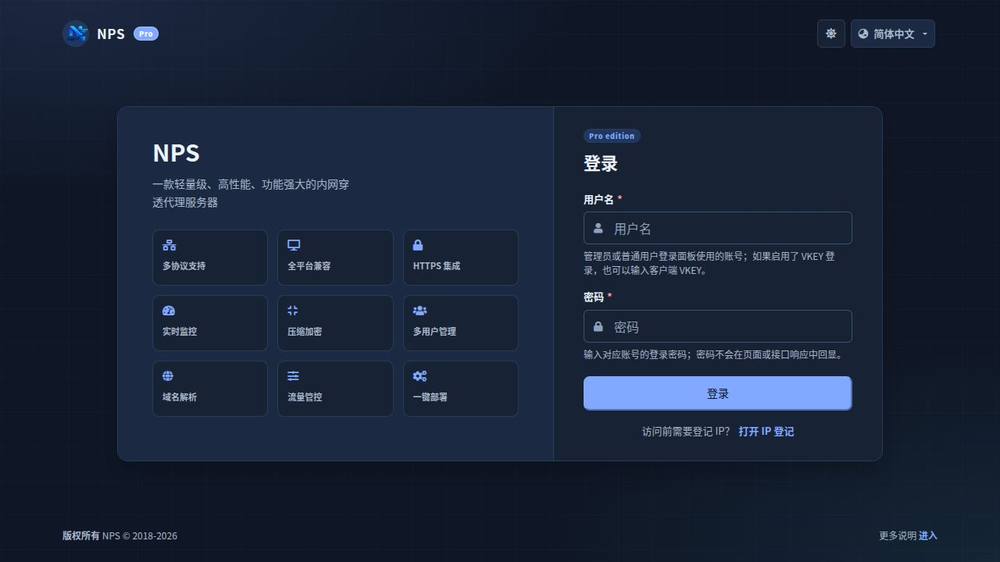
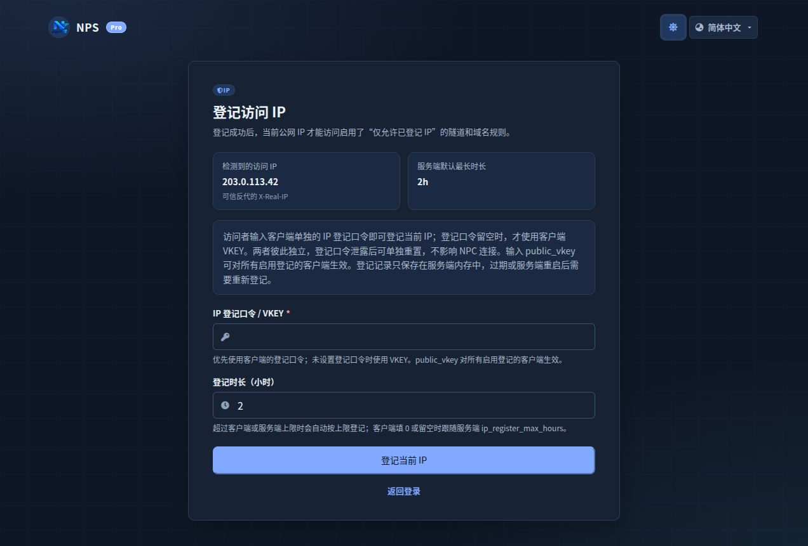
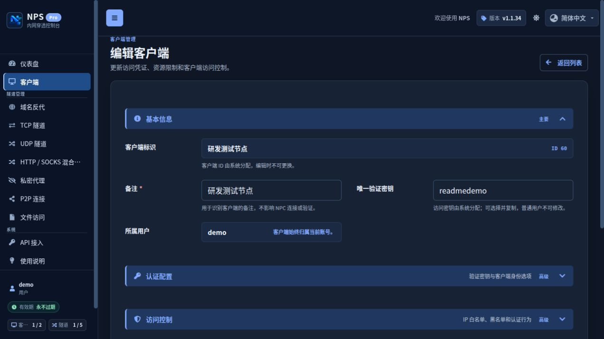
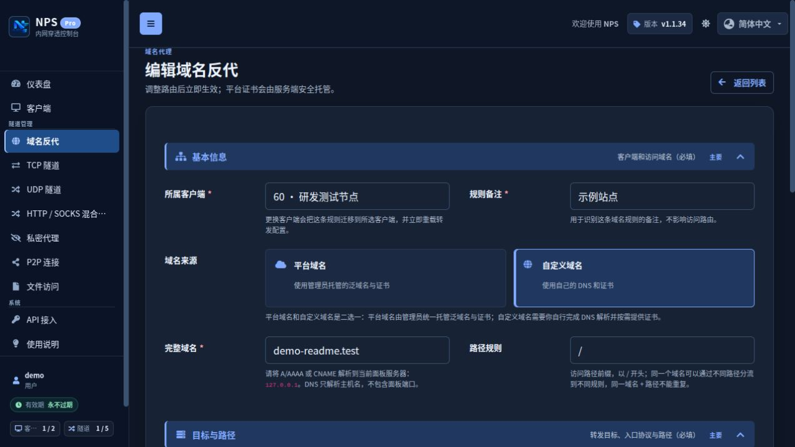

# NPS <sub>v1.1.39</sub>

[](https://github.com/ZiDuNet/nps/releases)
[](https://github.com/ZiDuNet/nps/stargazers)
[](https://github.com/ZiDuNet/nps/network/members)
[](https://hub.docker.com/r/wushuo98/nps)

NPS 是一款轻量级、高性能、功能强大的**内网穿透**代理服务器。支持 **TCP/UDP 流量转发、HTTP(S) 反向代理、HTTP / SOCKS 混合代理、P2P 穿透**等，并配备现代化 Web 管理面板。

项目提供独立的多用户管理与资源隔离：管理员可创建用户并将多个客户端分配给同一个用户；普通用户也可在管理员配置的客户端配额内自行创建客户端。用户与客户端到期时间独立保存，客户端到期不得晚于用户到期，客户端留空时跟随用户。

## 界面预览

| 登录页 | IP 登记页 |
| :---: | :---: |
|  |  |
| **客户端编辑** | **域名反代编辑** |
|  |  |

## 使用场景

| 场景 | 推荐模式 | 说明 |
|------|----------|------|
| 微信公众号/小程序开发 | HTTP(S) | 域名代理，将内网服务暴露到外网 |
| SSH 远程连接 | TCP | 端口转发，映射内网机器 22 端口 |
| 内网 DNS/游戏服务器 | UDP | UDP 端口转发 |
| 内网资源全面访问 | SOCKS5 | 代理访问，如同 VPN |
| 安全临时连接 | Secret | 私密代理，一次性连接 |
| 点对点直连 | P2P | 中继协助建立直连 |

## 特性

- 🚀 **协议全面** — TCP、UDP、HTTP(S)、SOCKS5、P2P、Secret、文件访问
- 🖥️ **跨平台** — Linux / Windows / macOS / ARM / 群晖，支持一键安装为系统服务
- 🎨 **Web 管理** — 面向运维的控制台，支持明暗主题、响应式布局、中英文切换、键盘可访问交互和实时流量监控
- 👥 **用户体系** — 支持一个用户管理多个客户端，支持客户端自建配额、用户级隧道配额和到期管理
- 🔒 **安全增强** — 首次启动随机密码、IP 白名单/黑名单、验证码、限速限流
- 🌐 **域名代理** — 自定义 Header、URL 路由、平台泛域名池、规则诊断、自动 HTTPS 与证书热更新
- 🔐 **TLS 加密** — 客户端与服务端之间 TLS 加密通信
- 📦 **Docker 部署** — 多平台镜像（amd64/arm/arm64），一键启动
- 🔌 **开放 API** — 统一 `/api/v1`，覆盖客户端、隧道、域名反代、用户、全局配置、Geo、IP 登记与审计，支持管理员签名和普通用户独立 Token
- 💻 **GUI 客户端** — 基于 Wails 的桌面客户端，支持 Windows/macOS/Linux 桌面环境

## 快速开始

### 服务端

```bash
# 直接运行
./nps

# 安装为系统服务
./nps install
nps start

# Docker 部署
docker run -d --name nps \
  -p 80:80 -p 443:443 \
  -p 8024:8024 -p 8025:8025 \
  -p 127.0.0.1:8081:8081 \
  -e NPS_WEB_IP=0.0.0.0 \
  -v /opt/nps/conf:/conf \
  wushuo98/nps
```

新安装默认只监听本机。使用上面的 Docker 示例时，请在宿主机访问 `http://127.0.0.1:8081`，或通过 HTTPS 反向代理发布该回环端口。首次启动会在终端打印管理员账号 `admin` 和随机生成的密码。发布模板中的 `CHANGE_ME` 和历史弱默认值会自动轮换；显式自定义值或留空值会保留（历史共享密钥 `public_vkey=123` 会被关闭）。

<details>
<summary>📋 端口说明</summary>

| 端口 | 用途 |
|------|------|
| 80 | HTTP 反向代理入口 |
| 443 | HTTPS 反向代理入口 |
| 8024 | Bridge TCP（客户端连接） |
| 8025 | Bridge TLS（加密连接） |
| 8081 | Web 管理面板 |

</details>

### 客户端

```bash
# 交互式运行（推荐）
./npc

# 命令行模式
./npc -server=<IP>:8024 -vkey=<密钥>

# TLS 加密模式
./npc -server=<IP>:8025 -vkey=<密钥> -tls_enable=true

# 自签名证书建议固定服务端指纹（指纹见 nps 启动日志）
./npc -server=<IP>:8025 -vkey=<密钥> -tls_enable=true \
  -tls_fingerprint=<SHA-256指纹>

# Docker
docker run -d --name npc \
  wushuo98/npc -server=<IP>:8024 -vkey=<密钥>
```

> 💡 **推荐无配置文件模式**：删除 npc 目录下的 `conf` 文件夹，所有配置在服务端 Web 面板管理。

当前 Bridge 支持 TCP、KCP、WebSocket、WebSocket TLS（WS/WSS）与 QUIC；KCP、WS、WSS、QUIC 可使用独立的可选监听端口。TLS Bridge 使用独立 TLS 端口。QUIC Bridge 是加密的 UDP Bridge 入口，不是浏览器 HTTP/3 域名反向代理。同一 TCP 端口上的 Bridge、HTTP(S) 与 Web 管理复用仅适用于现有的限定分流模式。
TLS 客户端默认校验证书；也可使用 `-tls_ca_file` 和 `-tls_server_name`，不要在生产环境启用 `-tls_insecure_skip_verify=true`。

## 隧道模式

| 模式 | 说明 | 典型用途 |
|------|------|---------|
| **TCP** | TCP 端口转发，支持负载均衡 | SSH、远程桌面、数据库 |
| **UDP** | UDP 端口转发 | DNS、游戏、VoIP |
| **HTTP(S)** | 基于域名的反向代理 | 微信开发、Web 站点 |
| **HTTP / SOCKS 混合代理** | HTTP 正向代理与 SOCKS5 共用一个公网端口 | 浏览器代理、内网资源全面访问 |
| **P2P** | 点对点穿透 | 直连内网设备 |
| **Secret** | 私密代理 | 安全的临时连接 |
| **文件** | 内网文件访问 | 文件浏览与下载 |

## 项目结构

```
nps/
├── cmd/
│   ├── nps/           # 服务端入口
│   ├── npc/           # 客户端入口
│   └── npc/npc-gui/   # Wails GUI 客户端
├── bridge/            # Bridge 层（连接管理、隧道复用）
├── server/            # 服务端核心（代理模式实现）
├── client/            # 客户端核心
├── lib/               # 公共库
│   ├── file/          # 数据模型 + JSON 持久化
│   ├── conn/          # 连接协议封装
│   ├── nps_mux/       # 多路复用库
│   ├── rate/          # 限速器
│   └── crypt/         # TLS 证书管理
├── web/               # Web 管理面板（Beego）
├── conf/              # 配置文件 + 数据存储
├── docs/              # 文档网站（VuePress）
├── build.sh           # 跨平台构建脚本
├── Makefile           # 构建/测试/CI
└── Dockerfile.*       # Docker 构建
```

## 构建从源码

需要 Go 1.26+

```bash
# 快速构建
go build ./cmd/nps       # 服务端
go build ./cmd/npc       # 客户端

# Makefile（推荐）
make build                 # 构建 nps + npc
make test                  # 带竞态检测和覆盖率测试
make lint                  # golangci-lint

# 交叉编译
CGO_ENABLED=0 GOOS=linux GOARCH=amd64 go build -ldflags "-s -w" ./cmd/nps
CGO_ENABLED=0 GOOS=windows GOARCH=amd64 go build -ldflags "-s -w" ./cmd/npc

# GUI 客户端（需安装 Wails 3）
cd cmd/npc/npc-gui
wails3 build --tags npcgui
```

## Docker

### Docker Hub

- **服务端**: [wushuo98/nps](https://hub.docker.com/r/wushuo98/nps)
- **客户端**: [wushuo98/npc](https://hub.docker.com/r/wushuo98/npc)

### docker-compose 一键部署

```bash
git clone https://github.com/ZiDuNet/nps.git
cd nps
docker-compose up -d
```

## 宝塔面板

详见 [宝塔面板 Docker 部署指南](docs/bt.md)

## 文档

- 📖 [完整文档](docs/README.md)
- 📦 [安装部署](docs/install.md)
- 🚀 [快速开始](docs/start.md)
- ▶️ [运行命令速查](docs/run.md)
- 👥 [用户体系](docs/user.md)
- 🧭 [使用说明页面配置](docs/usage-guide.md)
- ⚙️ [服务端配置文件参考](docs/server/server_config.md)
- 📱 [客户端使用](docs/client/use.md)
- 🧾 [NPC 配置文件参考](docs/client/config-file.md)
- 🔧 [隧道详解](docs/tunnel.md)
- 🐳 [Docker 部署](docs/docker.md)
- 🖥️ [GUI 客户端](docs/gui.md)
- 🌐 [平台泛域名与证书热更新](docs/extend/platform-domain.md)
- 🔌 [对外 API v1](docs/api.md)
- 🔐 [API 鉴权与兼容](docs/extend/api.md)
- 🧾 [历史 Web API](docs/extend/webapi.md)
- ⬆️ [升级迁移](docs/migrate.md)

## 更新日志

详见 [CHANGELOG.md](CHANGELOG.md)

### 近期更新

- **v1.1.39** (2026-10-30) - 优化列表身份信息、用户与客户端联动筛选、隧道目标展示和域名访问入口。客户端列表保留双向流量列，备注与所属用户改为居中双行显示；HTTP/HTTPS 入口改为保留外链图标的明确按钮，隧道访问地址提供复制和 HTTP 尝试操作。

- **v1.1.38** (2026-10-29) - 统一所有列表页工具栏，完善客户端连接审计：补充服务端地址、Bridge 通道、握手阶段、客户端版本、公网/内网地址来源、账号状态及到期信息；详情使用终端式原始 JSON 展示。登录封禁和 IP 登记迁移到公共列表并增加筛选、分页，修复服务端分类配置的关联校验误拦，同时优化响应式配置卡片。

- **v1.1.37** (2026-10-29) - 新增 TCP、TLS、KCP、WS、WSS、QUIC 和 HTTP/3 的多 Bridge 连接命令展示与兼容 v2 快捷命令，完善多协议 NPC/GUI 与系统服务；新增用户共享并发和带宽额度、连接审计、独立证书设置页、自定义域名证书 API 约束，并重新设计注册与后台管理体验。

- **v1.1.36** (2026-10-29) - 自助注册改为独立用户体系，支持配置默认客户端/隧道配额、有效期、图片验证码、注册限频和可选 SMTP 邮箱验证；新增管理员注册 API、普通用户自有客户端 IP 登记管理、可配置使用说明页面、支持搜索与源码视图的服务端配置页，以及默认 Geo 数据自动加载。现有配置、Bridge 协议和 NPC 版本保持兼容。

- **v1.1.35** (2026-10-28) - 修复普通用户访问 `/user/api` 时页面白屏的问题，普通用户现可正常打开 API 接入页并管理个人 Token；用户管理、全局参数和管理员 API 密钥接口仍仅限管理员访问。新增非管理员页面与动作白名单回归测试，并在 README 首页增加登录、IP 登记、客户端编辑和域名反代编辑截图。

- **v1.1.34** (2026-10-26) - 调整列表与表单排版：域名反代列表移除「认证」列，改为在访问入口前显示 Basic 认证锁图标；域名反代与 TCP 隧道的展开详情统一为紧凑卡片布局；全局参数「平台泛域名」输入区改为单列并限制输入宽度。修复域名反代新增/编辑页在健康检查目标为空时保存被浏览器校验拦截的问题。

- **v1.1.33** (2026-10-26) - Web 删除客户端时向在线 NPC 下发「注册已删除」指令，新版 NPC 关闭该连接并停止重连，旧版 NPC 保持原行为；系统服务模式下仅当进程内最后一条连接被删除时才自动停止本机 NPC 服务，保留注册、不卸载。修复 NPC 数据通道关闭时的阻塞与文件描述符泄漏、Docker 镜像缺少 CA 证书的问题，并统一浏览器标签页图标。

- **v1.1.32** (2026-10-26) - 新增统一对外 API `/api/v1`，覆盖客户端、隧道、域名反代、用户、全局配置、Geo、IP 登记、审计、状态与拓扑；支持管理员签名、普通用户独立 Token、统一响应信封、JSON 请求体和有界分页。移除从未进入正式发布的 `/v1/auth/*` 别名，旧 `/auth/*` 和所有既有管理接口保持不变。

- **v1.1.31** (2026-10-26) - Secret/P2P 目标类型真正支持 TCP/UDP 转发并保留数据报边界，P2P 访客支持 Secret 回退；隧道新增连接数与流量配额；证书支持路径、上传、粘贴与校验；新增可复用 Token 的 API 接入页、Geo 数据在线更新和更完整的仪表盘；管理面板全面迁移 Bootstrap 5 并现代化。修复配置文件模式公共 vkey 注册卡死与 P2P 直连 QUIC 握手崩溃。

- **v1.1.30** (2026-10-25) - 完善 NPC 的自定义 DNS、出站代理（HTTP/HTTPS、SOCKS4/4a/5、环境代理）、本地出口 IP 绑定与远程目标转发；补齐 QUIC/KCP 的本地地址绑定和配置文件说明，并继续兼容旧客户端与旧配置。

- **v1.1.29** (2026-10-24) - 新增现代 P2P 与旧客户端兼容、安全 Bridge 挑战握手、HTTP/3 域名反代、可选 ACME 证书、GeoIP/Geosite ACL、NTP 校时、Secret 回退、服务端配置维护，以及 Web 配置的后端健康检查与规则级上下行限速。

- **v1.1.28** (2026-10-22) - 客户端详情安全显示 Basic/旧版用户名，并在域名解析页面补充跨域与兼容模式说明。
- **v1.1.27** (2026-10-22) - 修复 NPC 服务日志权限，并完善 CLI、GUI 手动/远程升级流程；下载升级包后校验 SHA-256 再替换。
- **v1.1.26** (2026-10-22) - 恢复 v1.1.24 功能基线与 v1.1.23 发布流水线；master 构建推送 `latest` 和不可变 SHA 测试镜像，正式发版只推送版本号镜像。
- **v1.1.25** (2026-10-22) - 正式版本标签统一触发 CI、文档部署、Docker 推送和 GitHub Release；Release 正文自动读取更新日志
- **v1.1.24** (2026-10-21) - 普通用户可删除自己名下的客户端；Docker `latest` 改为仅跟随正式版，master 测试镜像使用 SHA 标签
- **v1.1.23** (2026-10-21) - 管理员可从客户端列表下发 NPC 远程升级；客户端校验 Release 后按服务账户权限替换并自动重启

- **v1.1.22** (2026-10-15) - 修复 Bridge 连接、代理认证和更新包校验等兼容性问题。
- **v1.1.21** (2026-10-12) - 修复反向代理验证码路径、系统服务证书路径、SOCKS5 UDP 中继地址选择和服务端更新后的自动重启
- **v1.1.20** (2026-09-22) - 大屏快捷密钥加密持久化，授权账号刷新后可再次查看；用户 API Token 操作移入状态列
- **v1.1.19** (2026-09-22) - 增加普通用户 API Token 自助生成/撤销，以及管理员和普通用户隔离的只读大屏快捷地址
- **v1.1.17** (2026-09-21) - 增加 Linux GUI 依赖下载与 Wails 构建重试，修复正式发布偶发失败
- **v1.1.16** (2026-09-21) - 新增操作审计日志、按用户隔离的 API 令牌，以及带响应头安全处理的现代 Host 代理能力
- **v1.1.15** (2026-09-20) - 修复 MUX 关闭时丢弃已缓冲尾部数据的问题，Host 响应与 TCP 流会完整排空后再释放
- **v1.1.14** (2026-09-20) - 按用户大屏原型重建资源拓扑页面，并改为从控制台新标签页打开
- **v1.1.13** (2026-09-20) - 新增按账号授权范围展示客户端、隧道和域名规则的实时资源拓扑页
- **v1.1.12** (2026-09-19) - 修正双向流量和配额统计，明确隧道运行状态并显示 TCP 当前连接数
- **v1.1.10** (2026-09-10) - 修复 Linux NPC 注册 systemd 系统服务时引用临时解压路径的问题
- **v1.1.9** (2026-09-09) - 修复客户端关闭 HTTP 请求端时 Host 反向代理响应被截断的问题
- **v1.1.8** (2026-09-04) - 新增用户客户端配额、到期边界校验、自助客户端配置与透明品牌资源
- **v1.1.6** (2026-09-02) - 同步清新 ZUI 控制台、平台泛域名、证书热更新和 GitHub 发布元数据
- **v1.1.5** (2026-09-02) - 仪表盘权限隔离、代理速率与运行状态、无闪局部刷新、流式转发回归保护
- **v1.1.4** (2026-09-02) - 平台泛域名池、证书热更新加固、规则诊断和控制台表单改版
- **v1.1.3** (2026-09-01) - 修复发布流水线、内置更新兼容性和运维控制台布局
- **v1.1.2** (2026-06-23) - 稳定隧道表单切换、优化 Docker 构建缓存
- **v1.1.1** (2026-06-15) — 用户管理、多客户端归属、用户级隧道配额
- **v1.1.0** (2026-06-10) — Web UI 现代化改造、Bug 修复、安全加固
- **v1.0.0** (2026-05) — 二次开发基线、流量统计修复、Web UI 重设计

## 贡献

欢迎提交 Issue 和 Pull Request！

1. Fork 本仓库
2. 创建特性分支 (`git checkout -b feature/amazing-feature`)
3. 提交更改 (`git commit -m 'Add amazing feature'`)
4. 推送分支 (`git push origin feature/amazing-feature`)
5. 创建 Pull Request

## 许可证

[GPL-3.0](LICENSE)

## 致谢

项目仓库：[ZiDuNet/nps](https://github.com/ZiDuNet/nps)。
