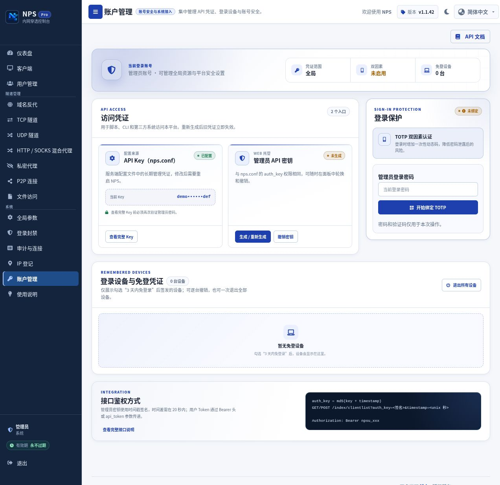

# 用户体系

v1.1.1 起，NPS 使用独立的 `User` 模型管理普通用户。一个用户可以关联多个客户端，登录后可以看到并管理自己名下的所有客户端、普通隧道和域名规则。管理员可以为每个用户设置客户端上限；普通用户可在上限内自行创建客户端，也可以使用管理员预先分配的客户端。

自助注册创建的账号默认不限制客户端数、隧道数、并发连接数、上行带宽、下行带宽和有效期。管理员可以在「系统 → 全局参数」的「用户注册」Tab 中统一调整这些默认权益；所有数值使用 `0` 表示不限制或永久有效。

## 角色

| 角色 | 来源 | 权限 |
|------|------|------|
| 管理员 | `conf/nps.conf` 中的 `web_username` / `web_password` | 全部权限 |
| 普通用户 | Web 面板「用户管理」创建或自助注册，保存到 SQLite 的 `conf/nps.db`（v1.1.52 从旧 JSON 升级时自动导入 `conf/users.json`） | 在客户端配额内创建/管理自己的客户端和资源 |

管理员可以访问用户管理和「系统 → 全局参数」；普通用户不能访问用户管理、全局参数、登录封禁和全局证书设置。用户管理列表会以用户名主行、备注次行显示账号信息，并显示每个用户当前关联的客户端数和隧道数，其中隧道数包含普通隧道与 Host 域名规则，与用户级配额使用同一统计口径。

## 数据关系

```text
User
  └── Client
        ├── Tunnel
        └── Host
```

- `User`：登录账号、密码、状态、备注、到期时间、最大客户端数、用户级隧道上限、共享并发连接数、共享上下行带宽，以及可轮换的用户 API Token 哈希。
- `Client`：客户端连接实体，保存 `VerifyKey`、限速、流量限制、连接数、客户端级隧道上限、所属用户。
- `Tunnel`：TCP、UDP、SOCKS5、HTTP 代理、Secret、P2P、文件访问等普通隧道。
- `Host`：HTTP/HTTPS 域名代理规则。

## 管理员推荐流程

1. 进入「用户管理」创建普通用户。
2. 设置用户状态、备注、到期时间、最大客户端数、最大隧道数、最大并发连接数和共享上下行带宽。数值填 `0` 表示不限。
3. 进入「客户端」新增客户端，选择所属用户；已有客户端也可在编辑页重新选择所属用户。服务端会校验用户确实存在和客户端配额，避免保存一个不可见的归属 ID。
4. 普通用户登录后即可看到已分配的客户端，并可在剩余客户端配额内点击「新增」自行创建客户端。

管理员仍可统一创建和分配客户端；两种方式使用同一套归属、配额和到期校验。

这种方式适合客户、团队、门店、设备组等场景。管理员可以统一分配已有客户端，也可以把创建权交给普通用户；普通用户始终只管理自己名下资源。

## 仪表盘用量趋势

普通用户的“用量趋势”只显示自身账号范围内经过 NPS 代理的用量；使用 VKey
登录时仅显示对应客户端，不包含 P2P 直连。旧版历史文件会自动兼容，保留期内
已有的采样不必删除重建；首次采集需要等待一个采样周期才会显示第一个点。
分钟精度默认保留 48 小时，五分钟精度默认保留 90 天，过期采样由服务端自动
清理。已删除资源的空历史也会在采样全部过期后回收，离线客户端不会被提前清空。

## 登录兼容

系统优先使用 `User` 表登录，支持“用户名 + 密码”和“绑定邮箱 + 密码”。用户名保持精确匹配，邮箱不区分大小写；若某个已有用户名恰好与其他账号邮箱相同，优先匹配用户名，不会自动切换到另一账号。重复的历史邮箱不会被随机用于登录或找回。

为了兼容旧版本，`allow_user_login=true` 且 `allow_user_vkey_login=true` 时仍保留旧客户端登录方式。客户端新增/编辑页中的“旧版客户端登录兼容”是一个可选的高级设置，不是“所属用户”的替代品：

- 如果客户端设置了 `WebUserName` 和 `WebPassword`，旧账号仍可登录。
- `user + VerifyKey` 始终可用于对应的有效客户端，即使客户端配置过旧版面板账号。也可以使用客户端旧版面板用户名，或该客户端所属用户的用户名/绑定邮箱，搭配这个客户端的 VKey 登录。
- 使用 VKey 登录后仅能访问对应客户端，不能获得所属用户的其他客户端权限；无关账号名不能搭配该 VKey 登录。
- 关闭 `allow_user_vkey_login` 后禁止旧客户端凭据登录、恢复免登及继续使用旧客户端网页会话，不影响独立用户账号和管理员登录。该开关不影响 NPC 的 Bridge 连接认证。
- 编辑客户端时密码不会回显；密码输入框留空表示保持原值，管理员可以显式清除旧版凭据。

新部署建议使用「用户管理」创建普通用户，不再把 Web 登录账号写在客户端上。

### 找回密码

只有 `allow_user_register=true` 时，登录页才在“注册”旁显示“找回密码”；关闭注册后，找回页面跳回登录页，发送验证码和重置接口均拒绝请求。该功能复用「全局参数 → 用户注册」中的 SMTP 配置，不要求同时开启 `register_email_verify`，但账号必须已绑定邮箱。没有邮箱的旧用户、管理员账号应联系管理员处理；客户端 VKey 不通过此流程修改。

1. 打开“找回密码”，填写绑定邮箱并获取验证码；启用注册或登录图片验证码时，发送和重置均需校验图片验证码。
2. 填写邮件中的 6 位验证码、新密码和确认密码，然后提交。新密码长度为 6–128 个字节。
3. 重置成功后使用用户名或绑定邮箱和新密码登录。旧网页会话和 3 天免登凭证失效，API Token、客户端 VKey、配额与业务配置不变。

找回验证码与注册验证码隔离，10 分钟有效、一次使用；同一邮箱或来源 IP 的发送间隔为 60 秒，连续输错 5 次作废，同一 IP/邮箱每分钟最多 10 次找回请求。账号邮箱或密码变化会使之前的找回验证码失效。发送接口对不存在、停用和过期邮箱返回统一提示，邮件异步发送，不公开账号是否存在。SMTP 未配置、不可用或收不到邮件时请联系管理员。找回成功会写入用户自己可见的审计记录，日志不包含密码或验证码。

管理员可以在用户列表中生成用户专属 API Token；普通用户也可以在自己的「系统 → 账户管理」页面自行生成、查看或撤销 Token。同一页面还提供当前账号的登录设备、3 天免登凭证和“退出所有设备”；管理员可在此绑定或关闭 TOTP。Token 原文以加密形式保存，授权账号登录后可以再次查看。普通用户使用该 Token 调用 API 时自动按当前用户过滤资源，不能读取其他用户或系统级数据。新集成请使用 [`/api/v1`](api.md) 与 `Authorization: Bearer npsu_...`；管理员管理资源时必须使用 HMAC 请求头签名（或迁移期显式开启的旧版 `auth_key + timestamp` 兼容签名）或等价的网页管理密钥，不能用普通用户 Token 提权。



## 权限边界

普通用户登录后：

- 只能看到自己名下的客户端。
- 只能查看、创建、修改、删除自己客户端下的普通隧道。
- 只能查看、创建、修改、删除自己客户端下的 Host 域名规则。
- 可以新增自己的客户端，但客户端 ID、验证密钥和所属用户由系统分配，不可修改。
- 可以给自己名下的客户端设置独立到期时间；该时间不得晚于所属用户的有效期，留空表示跟随所属用户。
- 不能修改客户端级配额（流量、带宽、连接数、隧道数上限）或旧版 Web 登录凭据，这些由管理员维护。
- 可以删除自己名下的客户端；删除会同时清理该客户端的普通隧道、Host 域名规则和在线连接，并释放客户端配额。
- 新客户端可填写备注、Basic 认证用户名/密码、压缩、加密、黑白名单以及新版 IP 登记参数；这些字段只影响新客户端本身。
- 可以打开「系统 → IP 登记」，查看、撤销、清理或清空自己客户端下仍然有效的 IP 登记；其他用户和公共登记桶不会显示，也不能通过构造客户端 ID 越权操作。
- 可以打开「系统 → 使用说明」查看管理员配置的帮助页面；帮助内容为空、文件缺失或远程页面禁止嵌入时，页面仍会正常打开并给出明确状态。
- 可以打开「系统 → 审计与连接」查看近期已归属自己的管理、登录与连接记录；页面查询范围为对应文件最近最多 2000 条，搜索和筛选不扩展到更早历史。清理共享日志的入口及权限仅限管理员。
- 不能访问用户管理、全局参数、登录封禁和全局证书设置。

管理员在「系统 → 全局参数」的「全局参数」Tab 中维护帮助页面，详细配置方式见
[使用说明页面](usage-guide.md)。

## 配额规则

### 客户端级配额

客户端 `MaxTunnelNum` 限制单个客户端下的资源数量。

计数范围：

- 普通隧道（TCP、UDP、SOCKS5、HTTP 代理、Secret、P2P、文件访问）
- Host 域名规则

### 用户级配额

用户 `MaxTunnelNum` 限制该用户所有客户端下的资源数量。

例如用户 A 有 3 个客户端，用户级最大隧道数为 10，则这 3 个客户端下的普通隧道和 Host 规则总数不能超过 10。

`0` 表示不限制。

### 用户级连接与带宽

用户级限制按 `UserId` 汇总该用户拥有的全部客户端，而不是每个客户端各算一份：

- `MaxConn`：所有客户端共享的 NPS 转发并发连接上限。达到上限后，新连接被拒绝；调低上限不会主动断开已建立连接。`0` 表示不限。
- `UploadLimit`：访问者到内网后端方向的总带宽，单位 KB/s。该用户全部客户端和全部转发连接共享。`0` 表示不限。
- `DownloadLimit`：内网后端到访问者方向的总带宽，单位 KB/s。该用户全部客户端和全部转发连接共享。`0` 表示不限。

用户级限制会与客户端级、隧道/Host 级和全局限制叠加，任一有效上限都可能先触发。HTTP、HTTPS、WebSocket、TCP、UDP 和 SOCKS5 等经过 NPS 的转发会计入；P2P 直连不经过 NPS 数据面，因此不占用用户级分享带宽和并发连接额度。管理员修改带宽后，已经建立的连接会即时使用新的共享令牌桶；调低并发上限只影响后续新建连接。

### 客户端创建配额

用户 `MaxClientNum` 限制该用户名下客户端数量。管理员可以在「用户管理」新增或编辑用户时设置，`0` 表示不限制。管理员分配的客户端和普通用户自行创建的客户端使用同一个计数；已停用、已到期的客户端仍占用名额，只有删除或重新分配后才会释放。

客户端新增和重新分配由服务端原子校验，因此并发请求不会突破上限。普通用户不能通过 API 或 NPC 配置文件伪造所属用户、配额或验证密钥。

普通用户删除客户端同样会在服务端再次校验当前归属；如果管理员在并发操作中重新分配了客户端，删除请求会被拒绝。旧版按单个客户端登录的会话不能执行自助删除。

## 到期和停用

用户和客户端都支持到期时间。

- 用户到期时间是名下资源的硬上限。客户端独立到期时间只能早于或等于用户到期时间；管理员缩短用户到期时间前，需要先处理晚于新日期的客户端。
- 客户端到期时间留空表示跟随所属用户；用户也未设置到期时间时，客户端视为永不过期。用户没有到期时间时，管理员可为客户端设置独立的较早日期。
- 普通用户可以在客户端新增/编辑页设置自己名下客户端的独立到期时间，边界同样受所属用户有效期约束。
- 客户端的实际有效期取客户端独立日期和用户日期中较早者，列表会同时显示配置日期和实际有效期。
- 客户端到期后，系统会自动停用该客户端，断开连接，并清理该客户端下的隧道和 Host 运行资源。
- 用户到期后，系统会自动停用该用户，断开并清理其名下所有客户端资源；用户恢复后仍需检查客户端自身状态。
- 到期检查在服务启动时立即执行一次，之后每分钟执行一次。

到期时间支持常见格式，最终会保存为：

```text
2006-01-02 15:04:05
```

## 迁移说明

首次从旧 JSON 迁移时，系统会读取 `clients.json` 与 `users.json`，并将修复后的归属写入 SQLite。只有旧数据没有 `users.json` 时，才会从旧客户端账号恢复用户：

- 旧客户端如果有 `WebUserName` / `WebPassword`，会自动创建对应 `User`。
- 同名同密码会合并为同一个用户。
- 同名不同密码会生成 `用户名_客户端ID`，避免账号冲突。
- 迁移后客户端会写入 `UserId`。

如果客户端已有失效的旧 `UserId`，但旧用户名和密码与现有用户完全匹配，启动迁移会自动修复绑定。若 `users.json` 已存在且账号已被删除，则不会凭旧客户端字段重新创建账号；管理员可在客户端编辑页手动选择新的所属用户。

迁移保留客户端记录中的兼容登录字段，但不会继续使用原 JSON 作为存储。详细步骤见[升级迁移](migrate.md)。
